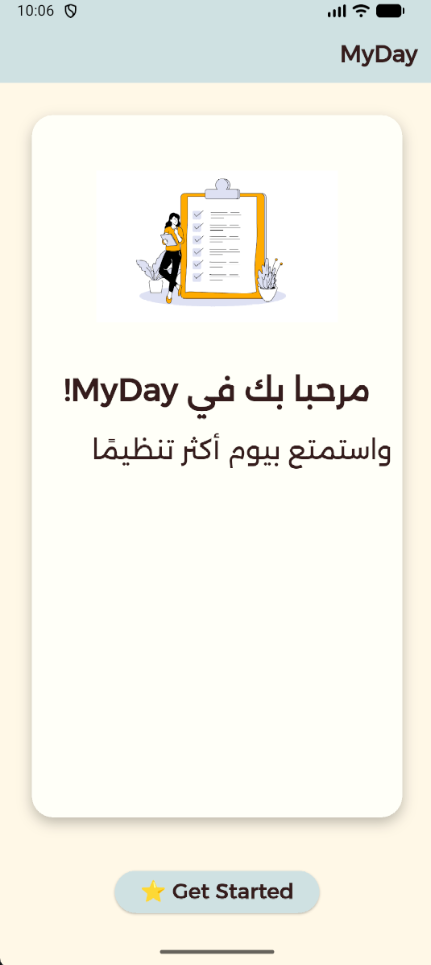
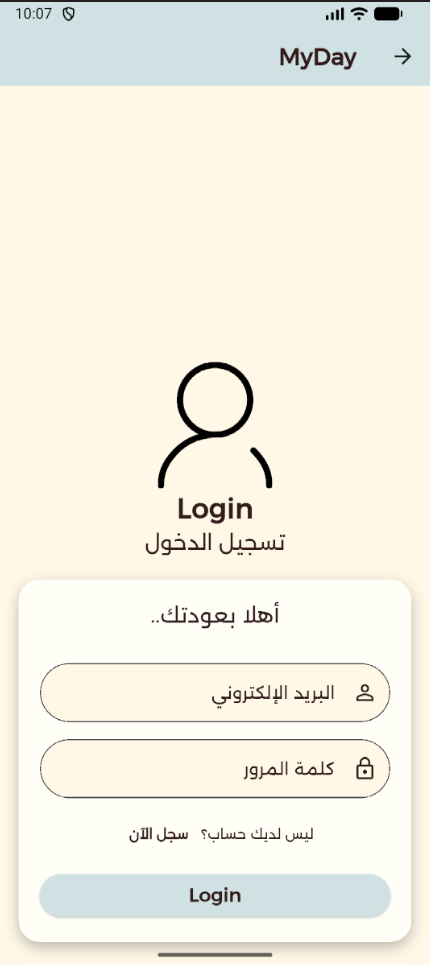
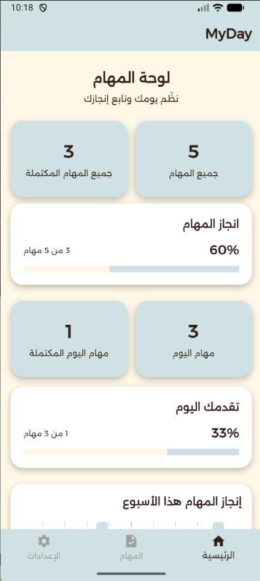
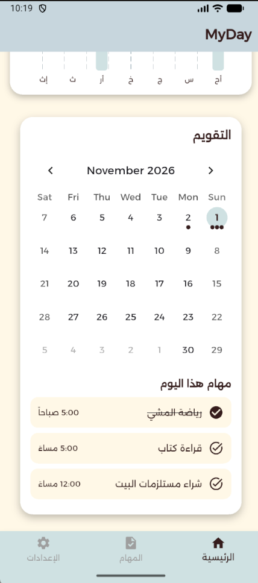
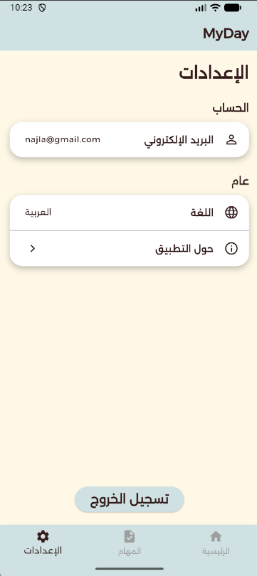

# MyDay – Daily Task Organizer

## About the Project
MyDay is an application that helps users organize their daily tasks and appointments in one place. It makes it easier to manage time, track progress, and plan daily activities.

## The Problem
Students and busy people often spread their tasks across notes, chats, and memory, so things get forgotten and it is hard to see how much of the day is actually done. Most task apps are also English-first and do not feel natural for Arabic speakers.

MyDay solves this by giving each user one place, tied to their account, to plan tasks by date and time, see them on a calendar, mark them as done, and follow their progress on a dashboard — all in a right-to-left Arabic interface.

## Features
- Add, edit, and delete tasks.
- View a calendar with tasks for each day.
- Mark tasks as completed or incomplete.
- Create an account and log in.
- Save tasks and link them to the user's account.
- Dashboard that summarizes task progress and provides an overview of completed and pending tasks.
- Responsive Arabic interface.

## Screenshots
| Welcome | Login | Dashboard | Calendar |
|---|---|---|---|
|  |  |  |  |

| Tasks List | Add Task | Edit Task | Settings |
|---|---|---|---|
|  |  |  |  |

## Technologies Used
- Flutter for app development.
- Dart as the programming language.
- Supabase for authentication and task data management.
- Git and GitHub for version control.

## Getting Started

### Prerequisites
- Flutter SDK (Dart `^3.10.8`)
- A [Supabase](https://supabase.com) project with email/password authentication enabled

### 1. Create the `tasks` table
In the Supabase SQL editor run:

```sql
create table public.tasks (
  id           bigint generated always as identity primary key,
  user_id      uuid not null references auth.users (id) on delete cascade,
  title        text not null,
  description  text not null default '',
  date         date not null,
  task_time    time not null,
  is_completed boolean not null default false
);

alter table public.tasks enable row level security;

create policy "Users manage their own tasks"
  on public.tasks for all
  using (auth.uid() = user_id)
  with check (auth.uid() = user_id);
```

### 2. Add your Supabase keys
Copy `.env.example` to `.env` in the project root and fill in your project's values:

```
SUPABASE_URL=https://your-project.supabase.co
SUPABASE_PUBLISHABLE_KEY=your-supabase-publishable-key
```

`.env` is ignored by Git. It must exist before building, because it is bundled as an asset.

### 3. Run the app
```bash
flutter pub get
flutter run
```

### Checks
```bash
flutter analyze
flutter test
```

`test/tasks_crud_test.dart` drives adding, editing, completing and deleting a task through the real UI, using an in-memory fake instead of Supabase.

## Challenges and How I Solved Them
- **Keeping the Supabase keys out of the repository.** The URL and key were first written directly in the code. I moved them into a `.env` file loaded with `flutter_dotenv`, added `.env` to `.gitignore`, and committed a `.env.example` template instead.
- **Arabic, right-to-left layout.** The whole app is wrapped in `Directionality(textDirection: TextDirection.rtl)` and uses the Alexandria font. Times are stored as `HH:mm:ss` in the database and shown in Arabic 12-hour format (صباحاً / مساءً) through a small helper (`services/time_arabic.dart`).
- **Matching dates and times to the database.** Flutter's `DateTime` and `TimeOfDay` do not map directly onto Supabase's `date` and `time` columns. `TaskService` handles the conversion in one place (`formatDateForDb` and `formatTimeForDb`), and the `Task` model handles mapping rows to objects (`fromMap` and `toMap`).
- **Keeping each user's data private.** Every query filters by the logged-in user's id, and the table uses Row Level Security so users can only read or change their own tasks.
- **Tasks page logic growing inside the widget.** CRUD calls, the edit dialog and the pickers were moved into `TasksController`. Shared picker styling was moved to `TaskPickerHelper`, and helper files that were no longer used were deleted.
- **Testing without a live backend.** `TaskService` and `TasksController` are passed into the pages through their constructors, so tests can swap in an in-memory fake service.
- **Using `BuildContext` after `await`.** Navigation and snackbars are guarded with `mounted` checks so the app does not crash when a page closes while a request is still running.

## AI Tools Used
- **Claude Code (Anthropic):** used to review the code and the folder structure, find and remove unused files, fix analyzer warnings, write the CRUD widget test, and help write this README. I reviewed and tested every suggestion before keeping it.


## Target Audience
Students and anyone who wants to organize daily tasks, manage appointments, and track their progress.

## Future Improvements
- Add reminders and notifications.
- Introduce goals and habit tracking.
- Integrate an AI assistant to help organize tasks.

---

